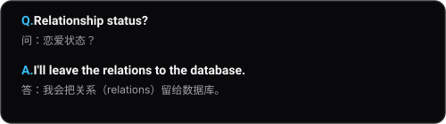
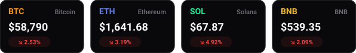

  
  <a href="https://xerafun.com">
    <picture>
      <source media="(prefers-color-scheme: dark)" srcset="./assets/typing-dark.svg" />
      <source media="(prefers-color-scheme: light)" srcset="./assets/typing-light.svg" />
      
    </picture>
  </a>

<!-- Snake Code Contribution Map -->
<picture>
  <source media="(prefers-color-scheme: dark)" srcset="https://cdn.jsdelivr.net/gh/xerafun/x-actions-profile@output/snake-dark.svg" />
  <source media="(prefers-color-scheme: light)" srcset="https://cdn.jsdelivr.net/gh/xerafun/x-actions-profile@output/snake-light.svg" />
  
</picture>

  
More...

    <picture>
      <source media="(prefers-color-scheme: dark)" srcset="https://cdn.jsdelivr.net/gh/xerafun/x-actions-profile@output/top-langs-compact-dark.svg" />
      <source media="(prefers-color-scheme: light)" srcset="https://cdn.jsdelivr.net/gh/xerafun/x-actions-profile@output/top-langs-compact-light.svg" />
      
    </picture>
    <picture>
      <source media="(prefers-color-scheme: dark)" srcset="./assets/joke-dark.svg" />
      <source media="(prefers-color-scheme: light)" srcset="./assets/joke-light.svg" />
      
    </picture>

  <a href="https://data.xerafun.com">
    <picture>
      <source media="(prefers-color-scheme: dark)" srcset="./assets/crypto-dark.svg" />
      <source media="(prefers-color-scheme: light)" srcset="./assets/crypto-light.svg" />
      
    </picture>
  </a>

<!-- programming tool icon 编程工具图标 -->
<!--   -->

